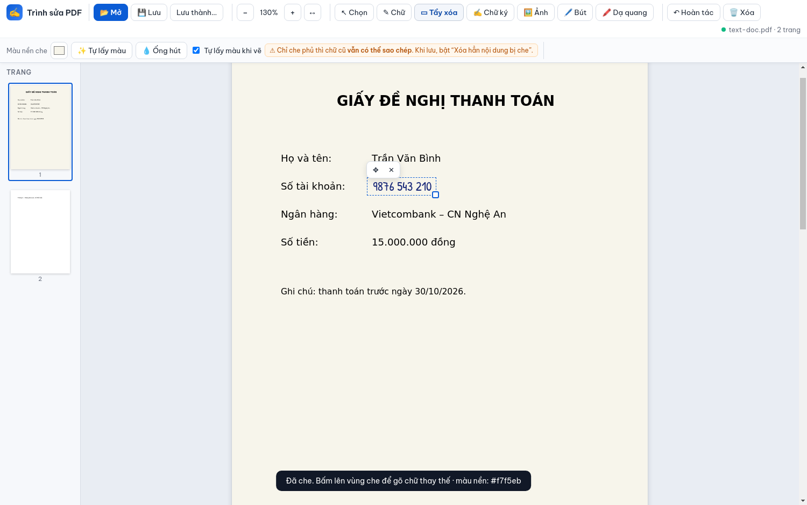
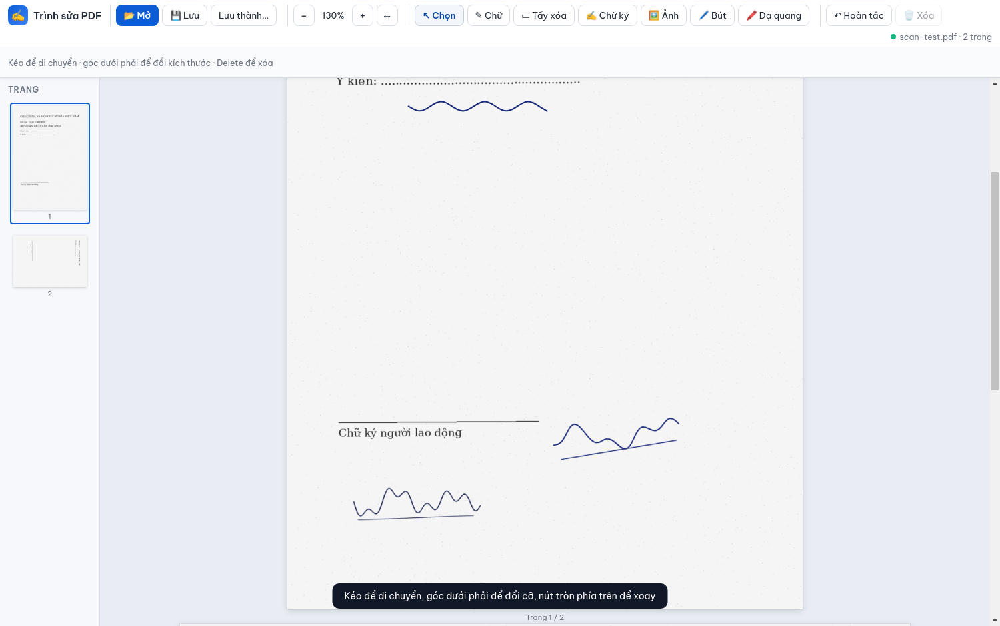

# Trình sửa PDF (TrinhSuaPDF)

Ứng dụng desktop **Electron** (giao diện tiếng Việt) để chỉnh sửa PDF thường và PDF scan: thêm chữ viết tay, tẩy/che nội dung (khung, cọ xoá, khoanh vùng), bút/bút dạ quang, chữ ký vẽ hoặc nhập ảnh, xem thumbnail trang. Chạy **ngoại tuyến** — thư viện PDF và phông chữ được đóng gói sẵn trong app.

Phiên bản trình duyệt một file (CDN) nằm ở [`web/index.html`](web/index.html).





## Tính năng chính

- Mở PDF scan nhiều trang hoặc PDF chữ thường; zoom, cuộn, thumbnail bên phải.
- **29 phông** chia 4 nhóm — viết tay gọn, kiểu chữ ký, kiểu bác sĩ (viết nhanh), chữ in/serif/đánh máy. Tất cả đều đủ dấu tiếng Việt và được kiểm tra tự động (`npm run test:fonts`). Bộ chọn phông có **tìm kiếm**, **ghim phông hay dùng**, **chữ xem trước tuỳ chỉnh** và cảnh báo phông thiếu dấu.
- Công cụ **tẩy/che** với 3 kiểu: **khung chữ nhật**, **cọ xoá tự do**, **khoanh vùng tự do**.
  - **Bám dòng chữ**: khung tự nới cho phủ đúng dòng chữ (dùng lớp chữ của PDF); bấm gọn một chỗ là che trọn cả dòng. PDF scan không có lớp chữ thì bỏ qua.
  - **Nền che** chọn được: một màu, **chuyển sắc theo nền**, hoặc **sao chép dải nền phía trên**; thêm tuỳ chọn **mờ mép** cho khỏi lộ đường viền. Có nút tự lấy màu và ống hút.
  - Tùy chọn **xóa hẳn** khi lưu: chọn **định dạng ảnh (tự động / PNG / JPEG)**, **độ phân giải (150–600 dpi)** và chất lượng JPEG.
- **Chữ ký**: vẽ trên pad, nhập ảnh (tách nền tự động theo Otsu, tự cắt sát, làm đậm/mảnh nét), thư viện chống trùng lặp. Thư viện lưu tại `%APPDATA%\TrinhSuaPDF\signatures` (Windows) hoặc tương đương trên Linux/macOS.
- Bút, bút dạ quang; xuất PDF qua pdf-lib + fontkit, nhúng phông theo **subset** để file nhẹ.
- Đóng gói Windows x64: file **portable** và **NSIS installer** (electron-builder).

## Cấu trúc thư mục

```
app/          # Ứng dụng Electron (main.js, preload.js, renderer/, build/, test/)
web/          # Bản web một file (index.html)
docs/         # Ảnh minh họa cho README
```

## Chạy trong môi trường phát triển

Yêu cầu: **Node.js 18+**.

```bash
cd app
npm install
npm start
```

Mở PDF qua menu **Mở** hoặc kéo thả; lưu bằng **Ctrl+S** / **Ctrl+Shift+S** (tùy chọn xóa hẳn).

## Build file `.exe` cho Windows

Trong thư mục `app/`:

```bash
npm install
npm run build
```

Kết quả trong `app/dist/` (portable và bộ cài NSIS). Trên **Linux**, build Windows cần thêm **Wine** (và thường cả wine32/i386) để electron-builder chạy trình cài/gói Win:

```bash
# Ví trên Debian/Ubuntu (tùy distro)
sudo dpkg --add-architecture i386   # nếu cần
sudo apt update && sudo apt install -y wine wine32
cd app && npm run build
```

## Kiểm thử

Cài dependency cho test (Playwright **core**, không tải trình duyệt):

```bash
cd app/test/tools && npm install
cd ../..
```

- **Smoke test** (headless, cần `xvfb` trên Linux):

  ```bash
  cd app
  xvfb-run -a npm test
  ```

- **E2E đầy đủ** (tương tác UI, lưu PDF mẫu vào `test/out/`):

  ```bash
  xvfb-run -a npm run test:e2e
  xvfb-run -a npm run test:overlay
  ```

- **Chữ ký** (khoá các lỗi đã sửa: nét cũ còn sót, đổi màu nét trên JPG, thư viện trùng lặp):

  ```bash
  npm run test:signature
  ```

- **Tẩy/xoá** (bám dòng chữ, cọ, khoanh vùng, nền chuyển sắc, chất lượng xoá hẳn —
  có render lại PDF đã lưu để soi điểm ảnh):

  ```bash
  npm run test:erase
  ```

- **Phông chữ**: kiểm tra độ phủ 146 ký tự tiếng Việt của mọi file trong
  `renderer/fonts/`, và nhúng thử tất cả phông vào PDF:

  ```bash
  npm run test:fonts
  ```

  Thêm phông mới:

  ```bash
  node test/fonts-fetch.mjs test/fonts-candidates allura italianno   # tải .ttf từ kho google/fonts
  node test/fonts-coverage.mjs --dir test/fonts-candidates --no-write # chỉ nhận phông đủ 100% dấu
  ```

  > Lưu ý: tag `vietnamese` của Google Fonts **không** bảo đảm đủ dấu chồng — ví dụ Caveat,
  > Sacramento, Parisienne đều thiếu. Luôn kiểm tra trước khi thêm.

> Trên Windows/môi trường IDE gắn Electron, biến `ELECTRON_RUN_AS_NODE=1` có thể khiến
> electron chạy như Node thuần; các test đã tự bỏ biến này khi khởi động app.

## Giấy phép phông chữ

Các phông viết tay, phông chữ in và **Be Vietnam Pro** lấy từ [Google Fonts](https://fonts.google.com/), giấy phép **[SIL Open Font License (OFL)](https://scripts.sil.org/OFL)**. File `.ttf` nằm trong `app/renderer/fonts/`. Phông chuẩn PDF.js (Foxit/Liberation) có LICENSE kèm trong `app/renderer/vendor/standard_fonts/`.

## Hạn chế đã biết

- File `.exe` **chưa ký số** — Windows SmartScreen có thể cảnh báo khi chạy lần đầu.
- Khi bật **xóa hẳn**, các trang có vùng che trở thành **ảnh** (mất lớp chữ vector trên trang đó).
  Chọn **PNG** để giữ nét tối đa hoặc giảm **dpi** để file nhẹ hơn.
- **Không xoay trang** PDF.
- **Không hỗ trợ** PDF có mật khẩu / mã hóa.
- Bản web ([`web/index.html`](web/index.html)) mới có: mở PDF, thêm chữ viết tay, chọn/di chuyển, lưu —
  **chưa có** bút, dạ quang, chèn ảnh, chữ ký và công cụ tẩy/xoá.

## Tác giả

© 2026 Nguyễn Thanh Hưng — mã nguồn trong repo [HexDino/PDF_edit](https://github.com/HexDino/PDF_edit).
