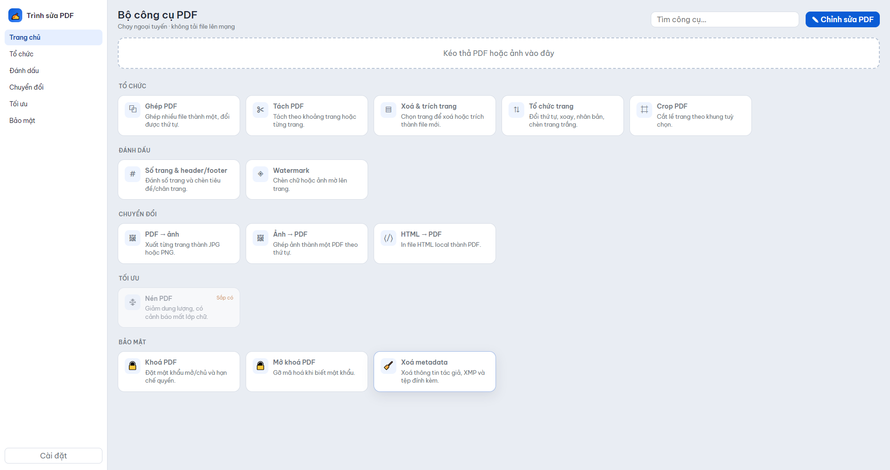
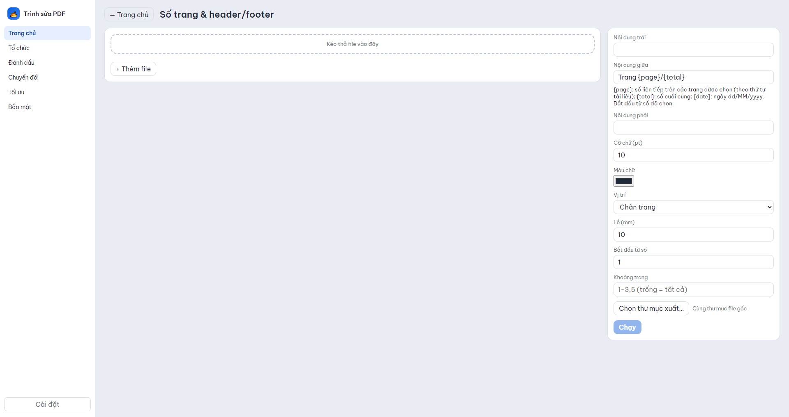
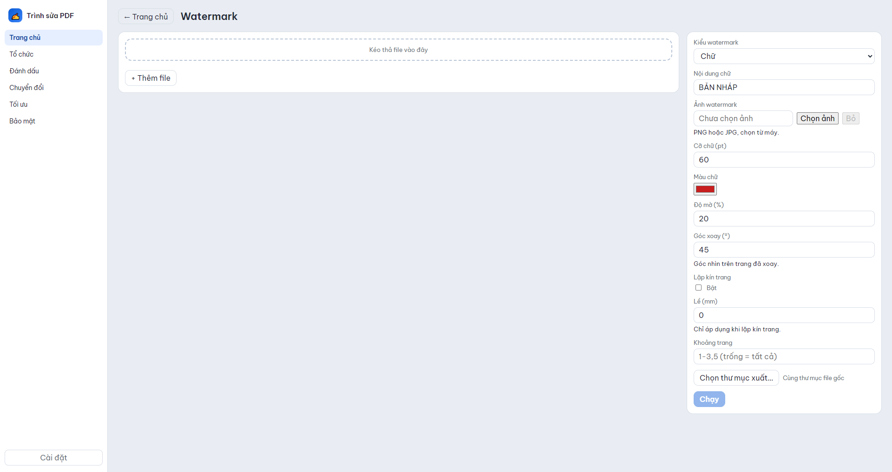

# Trình sửa PDF (TrinhSuaPDF)

Bộ công cụ PDF **ngoại tuyến** cho Windows x64, giao diện tiếng Việt: 13 công cụ xử lý PDF (ghép, tách, tổ chức trang, crop, số trang/header-footer, watermark, chuyển đổi, khoá/mở khoá, xoá metadata) cùng **trình sửa PDF** đầy đủ (chữ viết tay, tẩy/xoá, chữ ký, phiên chỉnh sửa).

Mọi thao tác chạy trên máy: không upload file, không telemetry. Mạng chỉ cần cho `npm install` và tải qpdf ở lần build đầu.



## Tải bản dựng sẵn

Tải ở trang [GitHub Releases](https://github.com/HexDino/PDF_edit/releases/latest):

- **`TrinhSuaPDF-1.2.0-portable.exe`** — chạy ngay, không cần cài đặt.
- **`TrinhSuaPDF-1.2.0-Setup.exe`** — bộ cài NSIS, tạo lối tắt và liên kết file PDF.
- **`SHA256SUMS.txt`** — mã kiểm tra toàn vẹn của các file tải về.

Yêu cầu: **Windows 10/11 x64**. File `.exe` **chưa ký số**, Windows SmartScreen có thể cảnh báo lần đầu — chọn *More info → Run anyway* sau khi đã kiểm tra SHA-256.

## Mục lục

- [Tải bản dựng sẵn](#tải-bản-dựng-sẵn)
- [Tính năng](#tính-năng)
- [Ảnh giao diện](#ảnh-giao-diện)
- [Cài đặt và chạy](#cài-đặt-và-chạy)
- [Build file .exe](#build-file-exe)
- [Kiểm thử](#kiểm-thử)
- [Cấu trúc repo](#cấu-trúc-repo)
- [Kiến trúc](#kiến-trúc)
- [Định dạng đầu ra](#định-dạng-đầu-ra)
- [Bảo mật và giới hạn đã biết](#bảo-mật-và-giới-hạn-đã-biết)
- [Giấy phép](#giấy-phép)
- [Tài liệu thiết kế](#tài-liệu-thiết-kế)

## Tính năng

### Bộ công cụ PDF (13 công cụ đang bật)

| Nhóm | Công cụ | Việc làm | Đầu ra |
|---|---|---|---|
| Tổ chức | **Ghép PDF** | Ghép nhiều PDF, giữ thứ tự trang | `<tên>-ghep.pdf` |
| Tổ chức | **Tách PDF** | Theo khoảng trang, mỗi N trang, hoặc từng trang | thư mục `<tên>-tach/` |
| Tổ chức | **Xoá & trích trang** | Xoá trang hoặc trích trang theo thứ tự nhập (cho phép lặp) | `<tên>-xoa-trang.pdf`, `<tên>-trich-trang.pdf` |
| Tổ chức | **Tổ chức trang** | Đổi thứ tự, xoay 90/180/270, nhân bản, chèn trang trắng | `<tên>-to-chuc.pdf` |
| Tổ chức | **Crop PDF** | Cắt lề mm theo vùng hiển thị, đúng trên trang xoay 0/90/180/270 | `<tên>-crop.pdf` |
| Đánh dấu | **Số trang & header/footer** | 3 ô trái/giữa/phải, `{page}`, `{total}`, `{date}`, cỡ/màu/lề, số bắt đầu, khoảng trang | `<tên>-so-trang.pdf` |
| Đánh dấu | **Watermark** | Chữ hoặc PNG/JPG, độ mờ, góc xoay, giữa trang hoặc lát kín | `<tên>-watermark.pdf` |
| Chuyển đổi | **PDF → ảnh** | JPG/PNG, DPI 72–600, chọn trang; cạnh dài tối đa 10.000 px | thư mục `<tên>-anh/` |
| Chuyển đổi | **Ảnh → PDF** | JPG/PNG/WebP theo thứ tự, khổ A4/A3/Letter/tự động, lề mm | `<ảnh-đầu>-anh.pdf` |
| Chuyển đổi | **HTML → PDF** | In file HTML local, khổ/hướng/lề/nền; chặn tài nguyên mạng | `<tên>-html.pdf` |
| Bảo mật | **Khoá PDF** | AES-256, mật khẩu mở/chủ, hạn chế in/sao chép/sửa | `<tên>-khoa.pdf` |
| Bảo mật | **Mở khoá PDF** | Gỡ mã hoá khi biết mật khẩu | `<tên>-mo-khoa.pdf` |
| Bảo mật | **Xoá metadata** | Xoá Info, XMP (catalog + trang), tệp đính kèm | `<tên>-xoa-metadata.pdf` |

**Nén PDF** đang ở trạng thái “Sắp có” — không giả vờ đã có.

Điểm chung của bộ công cụ:

- Hàng đợi job (tối đa 2 job song song), tiến độ theo bước, nút **Huỷ** dừng giữa chừng.
- **Không ghi đè**: nếu tên đích tồn tại, tự thêm ` (2)`, ` (3)`…; file gốc luôn được giữ nguyên.
- Chọn file/thư mục xuất qua hộp thoại; kéo-thả file vào cửa sổ.
- Lỗi hiển thị ngắn gọn bằng tiếng Việt; chi tiết kỹ thuật chỉ ghi log cục bộ.
- PDF có mật khẩu → báo cần mở khoá trước; PDF hỏng → báo file không đọc được.

### Trình sửa PDF (giữ nguyên từ bản 1.x)

- Mở PDF thường hoặc PDF scan nhiều trang; zoom, cuộn, thumbnail.
- **29 phông** viết tay/in, đủ dấu tiếng Việt, có tìm kiếm, ghim phông và chữ xem trước.
- **Tẩy/che** 3 kiểu (khung, cọ, khoanh vùng), bám dòng chữ, nền màu/chuyển sắc/sao chép, mờ mép, chọn PNG/JPEG và DPI khi “xoá hẳn”.
- **Chữ ký**: vẽ trên pad, nhập ảnh với tách nền Otsu, thư viện chống trùng, đặt nhanh vào góc trang hoặc tất cả trang.
- **Phiên chỉnh sửa** `‹tên›.tsp.json` nằm cạnh PDF gốc, mở lại file gốc là khôi phục đối tượng để chỉnh tiếp.
- Hoàn tác/làm lại (Ctrl+Z/Ctrl+Y), nhân bản (Ctrl+D), phím tắt V/T/E/P/H.
- Bút, bút dạ quang; xuất PDF bằng pdf-lib + fontkit, nhúng phông subset.

## Ảnh giao diện

| Số trang & header/footer | Watermark |
|---|---|
|  |  |

Ảnh editor (từ bản cũ, giao diện editor sẽ được thiết kế lại ở mốc M3):


## Cài đặt và chạy

**Yêu cầu**

- Windows 10/11 x64 (bản đóng gói và script tải qpdf dùng PowerShell).
- Node.js 22 trở lên (đã kiểm thử với Node 24).
- Internet cho `npm install` và lần đầu tải qpdf.

```bash
git clone https://github.com/HexDino/PDF_edit.git
cd PDF_edit/app

npm install          # Electron, pdf-lib, fontkit, công cụ build/test
npm run fetch:qpdf   # tải qpdf 12.4.2 (mingw64) + kiểm SHA-256 vào bin/win32-x64/
npm start            # mở trang chủ bộ công cụ
```

- Công cụ cần qpdf: Ghép, Khoá, Mở khoá. Thiếu qpdf thì các công cụ khác vẫn chạy, nhưng nên chạy `fetch:qpdf` một lần.
- Mở trình sửa: nút **Chỉnh sửa PDF** ở trang chủ, hoặc mở file `.pdf` bằng app.
- Dữ liệu cục bộ: log tại `%APPDATA%\TrinhSuaPDF\logs\tools.log`; thư mục job tạm tại `%TEMP%\TrinhSuaPDF\jobs`.
- Thư viện chữ ký: `%APPDATA%\TrinhSuaPDF\signatures`.

> `app/bin/` không được commit (qpdf + DLL khoảng vài MB). Build sẽ tự tải và kiểm tra SHA-256; có thể chạy `npm run fetch:qpdf` trước.

## Build file .exe

```bash
cd app
npm install
npm run build        # prebuild tự chạy fetch:qpdf
```

Kết quả trong `app/dist/`:

- `TrinhSuaPDF-1.2.0-portable.exe` — chạy ngay, không cần cài.
- `TrinhSuaPDF-1.2.0-Setup.exe` — bộ cài NSIS.

Ghi chú:

- File `.exe` **chưa ký số**; Windows SmartScreen có thể cảnh báo lần đầu.
- qpdf và DLL được đóng gói ngoài asar tại `resources/bin/win32-x64/`.
- Phông, pdf.js, pdf-lib được đóng trong `app.asar`; giấy phép Electron/Chromium nằm cạnh file chạy trong bản đóng gói.

## Kiểm thử

Chạy trong thư mục `app/`:

| Lệnh | Nội dung |
|---|---|
| `npm run test:tools` | Unit test toàn bộ engine PDF (Node, không cần Electron) |
| `npm run test:suite` | E2E Electron: trang chủ → chọn công cụ → chạy → kiểm tra file kết quả |
| `npm test` | Smoke test editor cơ bản |
| `npm run test:e2e` | E2E editor |
| `npm run test:overlay` | Overlay/annotation của editor |
| `npm run test:signature` | Chữ ký (12 kiểm tra) |
| `npm run test:erase` | Tẩy/xoá, gồm kiểm tra điểm ảnh sau khi xuất |
| `npm run test:editing` | Hoàn tác, nhân bản, đặt chữ ký nhanh |
| `npm run test:session` | Phiên `.tsp.json` |
| `npm run test:rotation` | Bám dòng và vị trí trên trang xoay 0/90/180/270 |
| `npm run test:fonts` | Độ phủ 146 ký tự tiếng Việt + nhúng thử 29 phông |

`npm run test:fonts` cần cài dependency test riêng:

```bash
cd app/test/tools && npm install && cd ../..
```

Các test Electron dùng `playwright-core` và tự bỏ biến `ELECTRON_RUN_AS_NODE` khi khởi động. Trên Windows không cần `xvfb`; nếu chạy trên Linux, dùng `xvfb-run -a` cho các test Electron.

## Cấu trúc repo

```
README.md
docs/                         Ảnh minh hoạ + tài liệu thiết kế/kế hoạch
app/
  main.js                     Tiến trình chính: cửa sổ, protocol, IPC, điều hướng
  preload.js                  API cầu nối renderer (editor + suite)
  suite/
    registry.js               Manifest 14 công cụ (nguồn duy nhất cho UI + main)
    jobs.js                   Hàng đợi job, temp, tiến độ, huỷ, log
    schema.js                 Validate tuỳ chọn theo schema
    pages.js                  Cú pháp khoảng trang 1-3,5,8-
    pdfops/                   Engine từng công cụ (pdf-lib + qpdf)
    render-worker.js          Cửa sổ ẩn render PDF bằng pdf.js
    image-worker.js           Cửa sổ ẩn giải mã WebP → PNG
    html-printer.js           Cửa sổ ẩn in HTML → PDF
    util/                     paths, spawn, log
  renderer/
    index.html, suite.js/css  Shell trang chủ + trang công cụ
    editor.html, app.js       Trình sửa PDF gốc
    worker/                   Trang ẩn cho render/ảnh
    vendor/                   pdf.js, pdf-lib, fontkit, cmaps, phông chuẩn
    fonts/                    29 phông + coverage.json
  scripts/fetch-qpdf.mjs      Tải qpdf + kiểm SHA-256
  test/                       Unit, E2E và các bộ test editor
  licenses/                   Apache-2.0, MIT fontkit
  THIRD-PARTY-NOTICES.txt     Khai báo bên thứ ba
```

## Kiến trúc

```
Renderer (index.html + suite.js)          Renderer (editor.html + app.js)
        │  IPC: toolId + đường dẫn + tuỳ chọn        │  API bytes giữ nguyên
        ▼                                            ▼
Main process: registry → JobRunner (queue 2) → pdfops (pdf-lib / qpdf)
        │                    │
        │                    ├─ render-worker  (pdf.js, tuần tự)
        │                    ├─ image-worker   (WebP → PNG, tuần tự)
        │                    └─ html-printer   (printToPDF, chặn mạng)
        ▼
publishUnique → file kết quả (không ghi đè)
```

- Dữ liệu qua IPC của bộ công cụ là **đường dẫn file**, không phải bytes; editor vẫn giữ luồng bytes cũ.
- File người dùng chọn được đưa vào allowlist ở main; job-start chỉ nhận đường dẫn đã chọn. Đường dẫn ảnh watermark cũng phải qua hộp thoại chọn file.
- Mật khẩu PDF được truyền qua file đối số tạm của qpdf, không lên dòng lệnh, không ghi log; file đối số bị xoá ngay sau khi dùng.
- Mỗi job có thư mục tạm riêng và được dọn sau khi xong/huỷ; thư mục cũ (>1 giờ) được quét khi khởi động.

## Định dạng đầu ra

Hậu tố theo công cụ: `-ghep`, `-tach/`, `-xoa-trang`, `-trich-trang`, `-to-chuc`, `-crop`, `-so-trang`, `-watermark`, `-anh/`, `-anh.pdf`, `-html`, `-khoa`, `-mo-khoa`, `-xoa-metadata`.

- Mặc định ghi cùng thư mục file nguồn; đổi được bằng nút **Chọn thư mục xuất**.
- Trùng tên → thêm ` (2)`, ` (3)`…; không có tuỳ chọn ghi đè.
- Job lỗi/huỷ không để lại file kết quả dở dang.

## Bảo mật và giới hạn đã biết

**Bảo mật**

- Chạy offline; không tài khoản, không cloud, không telemetry.
- `contextIsolation: true`, `nodeIntegration: false`; preload chỉ mở các hàm cần thiết.
- Tiến trình con chạy bằng mảng tham số, `shell: false`; mật khẩu không lên dòng lệnh/log.
- HTML → PDF chặn `http/https/ws/wss`; tài nguyên mạng bị bỏ qua và job trả cảnh báo `NETWORK_BLOCKED`.
- Quyền in/sao chép/sửa của PDF chỉ là **hạn chế theo chuẩn PDF**, không phải DRM tuyệt đối.

**Giới hạn**

- **Nén PDF** chưa có (trạng thái “Sắp có”).
- Chưa có cảnh báo tự động “chữ ký số sẽ mất hiệu lực” khi sửa PDF đã ký — cần bổ sung cho toàn bộ công cụ.
- HTML → PDF vẫn cho phép tài nguyên `file:`/UNC cùng máy; WebRTC/STUN, DNS prefetch/preconnect không bị `webRequest` chặn. Không dùng công cụ này để mở HTML không tin cậy.
- Xoá metadata: xử lý Info, XMP catalog/trang, tệp đính kèm trong `/Names` và `/AF` catalog, dọn object không truy cập được từ trailer; **không** quét mọi vị trí metadata cấp trang/annotation, XFA, trailer ID — không nên coi là ẩn danh tuyệt đối.
- Ảnh → PDF: JPEG có EXIF xoay có thể hiển thị theo hướng gốc; PNG giữ alpha; WebP được làm phẳng nền trắng; khổ “tự động” với ảnh quá lớn có thể vượt giới hạn trang PDF.
- PDF → ảnh giới hạn cạnh dài 10.000 px (DPI bị hạ theo tỉ lệ).
- Watermark chữ dùng cố định Be Vietnam Pro, chưa cho chọn phông; chữ quá lớn có thể bị cắt ở mép trang. Watermark ảnh luôn thu vừa trang và không phóng to.
- Editor: không xoay hướng trang, không mở PDF có mật khẩu; “xoá hẳn” biến trang bị che thành ảnh (mất lớp chữ trên trang đó); file `.tsp.json` chứa nội dung đã thêm nên không gửi kèm khi chia sẻ PDF.
- Chưa có thumbnail kéo-thả, preview crop, file gần đây, màn hình cài đặt; editor sẽ được thiết kế lại ở mốc M3.
- File `.exe` chưa ký số.

## Giấy phép

- **Mã nguồn repo này:** `UNLICENSED` (xem `app/package.json`). Chưa cấp giấy phép sử dụng lại; liên hệ tác giả nếu cần.
- **Bên thứ ba** (khai báo đầy đủ tại [`app/THIRD-PARTY-NOTICES.txt`](app/THIRD-PARTY-NOTICES.txt)):
  - qpdf 12.4.2 — Apache-2.0 (kèm SHA-256 bản tải).
  - pdf-lib 1.17.1 — MIT.
  - @pdf-lib/fontkit 1.1.1 — MIT (`app/licenses/MIT-fontkit.txt`).
  - pdf.js — Apache-2.0 (© Mozilla Foundation), kèm giấy phép phông Foxit/Liberation.
  - pako 1.0.11 — MIT.
  - 29 phông chữ từ Google Fonts — SIL Open Font License 1.1.
  - Electron 33 / Chromium — MIT + giấy phép bên thứ ba, đóng gói kèm `LICENSE.electron.txt` và `LICENSES.chromium.html`.

## Tài liệu thiết kế

- Đặc tả tổng thể: [`docs/superpowers/specs/2026-10-28-ilovepdf-suite-design.md`](docs/superpowers/specs/2026-10-28-ilovepdf-suite-design.md)
- Kế hoạch từng mốc: [`docs/superpowers/plans/`](docs/superpowers/plans/)

## Tác giả

© 2026 Nguyễn Thanh Hưng — [HexDino/PDF_edit](https://github.com/HexDino/PDF_edit)
