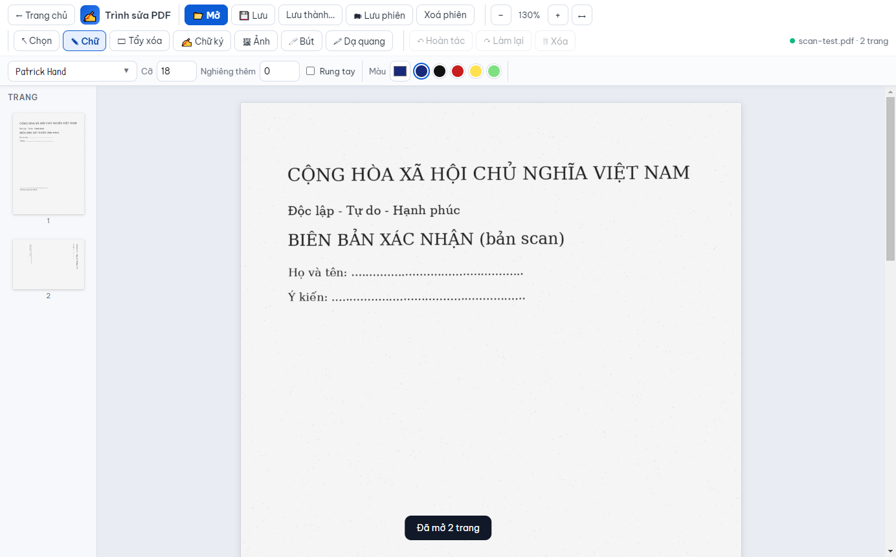
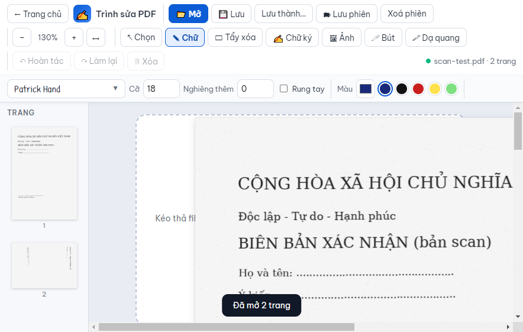

# M3 — Thiết kế lại giao diện Trình sửa PDF

**Ngày:** 2026-10-30 · **Trạng thái:** Đã duyệt hướng — rail + inspector phải; 3 điểm sửa `app.js`; hành động phiên trong menu “Tệp” · **Phạm vi:** `app/renderer/editor.html`, `styles.css`, thay đổi tối thiểu trong `app.js`

Mục tiêu: đưa editor về cùng hệ thống thiết kế với trang chủ/bộ công cụ, lấy **canvas làm trung tâm**, tách công cụ sang rail trái và thuộc tính sang panel phải — **không đổi bất kỳ hành vi nào**: mở/lưu, đối tượng, tẩy/xoá, chữ ký, ảnh, phiên `.tsp.json`, hoàn tác/làm lại, phím tắt và 8 bộ test cũ.




## 1. Vấn đề của giao diện hiện tại

Khảo sát `editor.html` (216 dòng), `styles.css` (159 dòng), `app.js` (1.607 dòng) và ảnh chụp thật:

1. **Hai hàng điều khiển dày đặc**: hàng 1 gồm 13 nút (mở/lưu/phiên/zoom/trạng thái), hàng 2 gồm 7 công cụ + thuộc tính. Ở 900 px, các nhóm tự xuống dòng, chiếm gần 200 px chiều cao, canvas chỉ còn ~500 px và xuất hiện cuộn ngang.
2. **Thuộc tính nằm trong header**, không theo đối tượng: chọn một vùng che vẫn thấy nhóm “Chữ” và ngược lại; người dùng phải quét cả hai hàng.
3. **Không có tên file/dirty state rõ ràng**: chỉ có chuỗi trạng thái `scan-test.pdf · 2 trang` lẫn với thông báo; trạng thái phiên là một tag nhỏ.
4. **Thumbnail cố định 150 px**, không thu gọn được; ở cửa sổ hẹp chiếm chỗ canvas.
5. **Font panel 460 px tuyệt đối** trong header; nếu chuyển thuộc tính sang panel 320 px sẽ tràn — cần flyout/modal riêng.
6. **Nút dạng chữ + emoji** không đồng nhất với icon/typography của shell; mật độ nút 32 px nhưng nhãn dài gây nhiễu.

## 2. Hợp đồng phải giữ (nguồn: `app.js` + 8 bộ test)

### 2.1 Phần tử app.js truy vấn trực tiếp

`header`, `#homeBtn`, `#openBtn`, `#saveBtn`, `#saveAsBtn`, `#saveSessionBtn`, `#clearSessionBtn`, `#zoomIn`, `#zoomOut`, `#zoomFit`, `#zoomLbl`, `#sigBtn`, `#imgBtn`, `#undoBtn`, `#redoBtn`, `#delBtn`, `#dot`, `#status`, `#sessionTag`, `#fontBtn`, `#fontBtnTxt`, `#fontPanel`, `#fontSearch`, `#fontPreviewText`, `#fontList`, `#sizeIn`, `#slantIn`, `#jitterIn`, `#colorIn`, `#penW`, `#rotIn`, `#recolorBtn`, `#snapLines`, `#brushW`, `#fillModeIn`, `#featherIn`, `#fillIn`, `#autoFillBtn`, `#pickBtn`, `#autoFillIn`, `#side`, `#thumbs`, `#viewer`, `#empty`, `#heroHand`, `#openBtn2`, `#pages`, `#sigModal`, `#pad`, `#padW`, `#padUndo`, `#padClear`, `#sigImgBtn`, `#sigImgCanvas`, `#sigImgEmpty`, `#bgRemove`, `#bgTol`, `#bgAutoBtn`, `#sigRecolor`, `#sigRecolorC`, `#sigCrop`, `#sigWeight`, `#libGrid`, `#sigAtBL`, `#sigAtBC`, `#sigAtBR`, `#sigAllPages`, `#saveLibWrap`, `#saveLib`, `#keepPadWrap`, `#keepPad`, `#sigUse`, `#saveModal`, `#saveInfo`, `#trueRemove`, `#flatOpts`, `#flatFormat`, `#flatDpi`, `#flatQuality`, `#flatQualityLbl`, `#flatHint`, `#saveGo`, `#fileInput`, `#imgInput`, `#sigImgInput`, `#measure`, `#toast`, `#busy`, `#busyTxt`.

### 2.2 Selector/class app.js và test dùng

| Selector | Ai dùng | Ghi chú |
|---|---|---|
| `[data-tool]` | app.js (document-wide), `test/e2e.mjs` | **Có thể chuyển sang rail trái** mà không sửa app.js |
| `[data-es]` | app.js | Nút kiểu xoá |
| `.ctx .sec[data-ctx]` + `.show` | app.js `syncControls()` | Panel phải chỉ cần đổi CSS, giữ nguyên cơ chế ẩn/hiện |
| `.ctx .sw` | app.js | Swatch màu |
| `#fontList .fi`, `.fi`, `.pin`, `.pv`, `.nm` | app.js, `test/e2e.mjs` | Font picker |
| `.th`, `.tdel`, `.cur`, `.deleted` | app.js, `test/e2e.mjs` | Thumbnail |
| `.page`, `.layer`, `.obj`, `.obj.sel`, `.tools`, `.mv`, `.dup`, `.del`, `.rs`, `.ro` | app.js, `test/editing.mjs`, `test/overlay.mjs` | Canvas + object |
| `.tb`, `.ln`, `.ink`, `.msk`, `.ls`, `.im`, `.hl`, `.feather`, `.rc` | app.js | Đối tượng |
| `body.tool-*`, `body.dragging` | app.js/CSS | Giữ nguyên class body |
| `.tabs [data-tab]`, `.dlg .tab`, `[data-close]` | app.js | Modal chữ ký/lưu |
| `header` | app.js (pointerdown guard) | Giữ thẻ `header` |

**Kết luận:** có thể thay cấu trúc trình bày mà không đổi một selector nào. Chỉ 3 điểm cần chạm `app.js` (mục 7).

## 3. Nguyên tắc thiết kế

- **Canvas-first**: vùng trang là lớn nhất; công cụ/ thuộc tính là chrome hai bên, có thể thu gọn.
- **Công cụ ở rail, thuộc tính theo ngữ cảnh**: chọn công cụ nào thì panel phải hiện đúng nhóm đó; chọn đối tượng thì hiện thuộc tính đối tượng.
- **Progressively disclosed**: hành động ít dùng (Lưu phiên/Xoá phiên) vào menu “Tệp”; hành động chính (Lưu) luôn hiện.
- **Đồng bộ shell**: dùng token `--blue #0b5cd5`, Be Vietnam Pro, nền `#e9edf3`, panel trắng, radius 10/14, shadow nhẹ; không gradient trang trí.
- **Tối giản, tiếng Việt**: nhãn ngắn; icon SVG một nét; tooltip cho icon-only; không emoji rải rác.
- **Không hồi quy hành vi**: thay đổi chỉ ở markup/CSS + 3 điểm nối trong app.js; test cũ là hợp đồng.

## 4. Bố cục đề xuất

```
┌──────────────────────────────────────────────────────────────────────────────┐
│ Top bar 56px: ←  [tên file + ●Đã lưu · phiên]   ↶ ↷   Lưu  Lưu thành…  Tệp ▾  − 130% + ↔   ● Trạng thái │
├──────┬──────────────┬──────────────────────────────────────────────┬──────────┤
│ Rail │ Thumbnails   │ Canvas (#viewer)                             │ Inspector│
│ 72px │ 168px (thu gọn)                                              │ 320px    │
│      │              │  ┌──────────────────────────┐                │ Thuộc tính│
│ V    │ [1] ảnh trang│  │  Trang PDF               │                │ [Chữ]     │
│ T    │ [2]          │  │  nội dung, đối tượng…    │                │ Phông chữ │
│ E    │ [3]          │  └──────────────────────────┘                │ Cỡ / nghiêng│
│ ✍    │              │                                              │ Màu       │
│ Ảnh  │              │                                              │ Ghi chú   │
│ P    │              │                                              │           │
│ H    │              │                                              │           │
│ ─    │              │                                              │           │
│ Trang│              │                                              │           │
├──────┴──────────────┴──────────────────────────────────────────────┴──────────┤
│ Hint bar 28px: Kéo để di chuyển · Delete để xoá · Ctrl+Z hoàn tác              │
└──────────────────────────────────────────────────────────────────────────────┘
```

Kích thước:

- Top bar 56 px; rail 72 px; thumbnails 168 px (mở) / 56 px (thu gọn chỉ còn nút mở); inspector 320 px; hint bar 28 px.
- Canvas tối thiểu 520 px ở 900×600 sau khi thu gọn hai panel.
- Khoảng cách 4/8/12/16; radius 8 (control), 10 (card), 14 (modal); shadow `0 8px 24px rgba(15,23,42,.10)`.

## 5. Thành phần

### 5.1 Top bar

- Trái: `#homeBtn` icon ← + tooltip “Trang chủ”; khối file gồm **tên file** (mới `#fileTitle`) và dòng phụ `● #status` + `#sessionTag`. Dirty hiển thị bằng chấm cam + chữ “Chưa lưu”; đã lưu chấm xanh.
- Giữa: `#undoBtn`, `#redoBtn` icon-only (aria-label + title).
- Phải: `#saveBtn` primary; `#saveAsBtn`; menu **Tệp ▾** chứa `#saveSessionBtn`, `#clearSessionBtn`; nhóm zoom `− #zoomLbl + ↔`; `#dot` + `#status` (trạng thái thao tác gần nhất).
- `#delBtn` icon thùng rác, disabled khi không chọn; giữ ID để app.js bật/tắt.
- Ở <1200 px: ẩn nhãn chữ của nút phụ, giữ icon + tooltip; menu Tệp vẫn mở được; top bar không xuống hàng (một hàng 56 px, overflow menu).

### 5.2 Rail trái

- 7 nút dọc, mỗi nút 48×48 (icon 18 + nhãn 12 px): Chọn, Chữ, Tẩy xoá, Chữ ký, Ảnh, Bút, Dạ quang.
- `#sigBtn`, `#imgBtn` là nút mở modal/chọn ảnh; các nút `[data-tool]` do app.js gắn sự kiện.
- Active: nền `#e6efff`, chữ/icon `--blue-d`, vạch 3 px bên trái.
- Cuối rail: nút thu gọn/mở thumbnails (icon), có `aria-expanded`.

### 5.3 Thumbnails

- Giữ `#side`/`#thumbs`; header “Trang · N” + nút thu gọn.
- Ảnh trang rộng 120 px, viền 2 px `--blue` khi `.cur`; nút xoá `.tdel` hiện khi hover; trang đã xoá mờ + nút hoàn tác như hiện tại.
- <1200 px: mặc định thu gọn; nhấn rail mở overlay 168 px đè lên canvas, có nút đóng.

### 5.4 Canvas

- `#viewer` nền `--bg`; `#pages` giữ gap 22, padding 26/20/80.
- Trang trắng, shadow nhẹ, số trang dạng pill dưới trang; giữ nguyên canvas render và layer.
- Empty state: card trắng 520 px, viền dashed, icon PDF, tiêu đề “Mở file PDF để bắt đầu”, nút `#openBtn2`, vẫn giữ `#heroHand` (chữ viết mẫu).
- Object đang chọn: outline xanh 1.5 px + mini-toolbar hiện có (nhân bản/xoá) + tay nắm resize/rotate; chỉ đổi CSS.
- Khi kéo file vào: viền dashed xanh quanh canvas (giữ `body.dragging`).

### 5.5 Inspector phải

- Header: “Thuộc tính” + chip ngữ cảnh (Chữ / Vùng che / Ảnh / Bút / Dạ quang / Chọn).
- Body chứa nguyên `.ctx` với các `.sec[data-ctx]`; app.js vẫn bật/tắt `.show`.
- Mỗi `.sec` là một card có tiêu đề nhóm (12 px, uppercase, màu `--mut`):
  - **Chữ**: nút phông full-width (preview + ▼), Cỡ + Nghiêng thêm 2 cột, công tắc Rung tay, Màu mực (5 swatch + input color).
  - **Bút/Dạ quang**: Màu, Độ dày nét.
  - **Tẩy xoá**: segmented Khung/Cọ/Khoanh, Bám dòng, Cỡ cọ, Nền che (select), Mờ mép, Màu nền + Tự lấy màu/Ống hút/Tự lấy khi vẽ, cảnh báo “chỉ che phủ” dạng note vàng.
  - **Ảnh**: Xoay, Đổi màu nét.
  - **Chọn**: hint thao tác.
- Font panel (`#fontPanel.open`): flyout rộng 380 px neo bên trái inspector, cao tối đa 70vh; giữ search/preview/pin; <1200 px chuyển thành modal giữa màn hình.
- <1200 px: inspector thành drawer 320 px trượt từ phải, có nút mở trên top bar và nút đóng; không chiếm chỗ canvas khi đóng.

### 5.6 Modal chữ ký / Lưu

- Giữ nguyên markup/ID; chỉ áp token: `.dlg` radius 14, header 56 px, tab segmented, footer sticky.
- Vùng pad cao 260 px; preview ảnh nền caro; lưới thư viện 3–4 cột; nút primary rõ.
- Modal Lưu: card “Xoá hẳn nội dung bị che” nổi bật; các tuỳ chọn ảnh gom trong khối; note cảnh báo màu vàng.

### 5.7 Trạng thái & phản hồi

- Hover/active/disabled/focus-visible đầy đủ; focus ring 2 px `#93b4f5`.
- Chấm trạng thái: xanh lưu/thành công, cam dirty/đang xử lý, đỏ lỗi.
- Toast giữ nguyên; busy overlay giữ nguyên; thêm `aria-live="polite"` cho `#status` và `#toast`.
- Chuyển động 140 ms; `@media (prefers-reduced-motion: reduce)` tắt transition.

## 6. Responsive

| Kích thước | Rail | Thumbnails | Inspector | Top bar |
|---|---|---|---|---|
| ≥1200 px | icon + nhãn | mở 168 px (thu gọn được) | cố định 320 px | đầy đủ |
| 900–1199 px | icon-only + tooltip | mặc định thu gọn, mở overlay | drawer overlay | ẩn nhãn phụ, menu Tệp |
| <900 px | không hỗ trợ (app min 900×600) | — | — | — |

## 7. Thay đổi `app.js` tối thiểu (được phép)

1. **Pointerdown guard**: hiện `document.querySelector('header').addEventListener('pointerdown', …)` chỉ bảo vệ header. Bọc top bar + rail + inspector trong `<div id="chrome">` và đổi selector sang `#chrome` để giữ vùng chọn chữ khi bấm công cụ/thuộc tính.
2. **Tên file**: thêm `#fileTitle`; cập nhật trong `loadPdf`/`save` bằng `basename(origPath)` (chỉ trình bày).
3. **Toggle panel**: 2 handler nhỏ cho nút thu gọn thumbnails/inspector (thêm/xoá class trên `<body>` hoặc `#chrome`); không đụng logic đối tượng/export/session.
4. `aria-label`/`title` cho icon-only; không đổi phím tắt hay handler hiện có.

Không thay đổi: `app.js` object model, export PDF, font subset, signature, session, undo/redo, zoom math, render PDF.js.

## 8. Kế hoạch di trú

Mỗi pha chạy đủ 8 bộ test editor + `test:tools`/`test:suite` khi chạm phần dùng chung.

1. **P1 — Khung & CSS**: chuyển `editor.html` sang top bar/rail/thumbs/canvas/inspector; đưa `.ctx` vào inspector; thêm `#chrome`, `#fileTitle`; CSS token mới. Chạy 8 bộ test; thêm `test/editor-dom-contract.mjs` kiểm tra đủ ID/selector hợp đồng.
2. **P2 — Top bar & inspector**: icon SVG, nhóm hành động, menu Tệp, font flyout, segmented control, swatches; test font picker + mở/đóng panel.
3. **P3 — Canvas & thumbnails**: empty state, page pill, object toolbar/resize handles, thumbnail collapse/overlay; test erase/editing/overlay/rotation.
4. **P4 — Modal, responsive, a11y**: restyle 2 modal; breakpoint 1200/900; focus/aria/reduced-motion; chụp 1400×900 + 900×600; chạy full battery + build; so sánh checklist chức năng.

Điều kiện dừng mỗi pha: 8 bộ test cũ xanh **không sửa selector**, không mất control nào, ảnh chụp đúng bố cục.

## 9. Tiêu chí nghiệm thu

- 100% chức năng editor hiện có hoạt động: mở/kéo-thả, zoom, thumbnail xoá/khôi phục, chọn/ghim/tìm phông, chữ + rung tay + nghiêng, tẩy 3 kiểu + bám dòng + nền + ống hút + xoá hẳn, bút/dạ quang, ảnh + xoay + đổi màu, chữ ký 3 tab + thư viện + đặt góc + tất cả trang, phiên lưu/khôi phục/xoá, hoàn tác/làm lại/nhân bản, phím tắt V/T/E/P/H, Ctrl+O/S/Shift+S/Z/Y/−/+.
- 8 bộ test cũ xanh, không đổi selector; test DOM contract mới xanh.
- Ảnh chụp 1400×900 và 900×600: không cuộn ngang, canvas ≥520 px, không cắt nút.
- Chữ ≥12 px; vùng bấm ≥32 px; focus-visible rõ; reduced-motion tôn trọng.
- Không thay đổi hành vi lưu/phiên/chữ ký/export; không thêm dependency.

## 10. Rủi ro & câu hỏi mở

- **Selection loss**: di chuyển `.ctx` ra khỏi `header` có thể làm mất vùng chọn chữ khi bấm thuộc tính — xử lý bằng `#chrome` guard (mục 7.1), cần test thủ công với công cụ Chữ.
- **Font panel**: 460 px không vừa inspector 320 px → flyout 380 px; ở 900 px thành modal; cần kiểm tra `#fontPanel.open` vẫn do app.js điều khiển.
- **Mật độ 900×600**: nếu drawer inspector che canvas nhiều, có thể giảm còn 300 px hoặc cho phép thu gọn thumbnails mặc định; cần ảnh chụp để chốt.
- **Tên file/dirty**: cần thêm `#fileTitle` và cập nhật app.js; nếu không muốn chạm app.js, có thể tạm dùng `#status` (không đạt yêu cầu tên file rõ ràng).
- **Menu Tệp**: dùng `<details>` CSS-only hay handler nhỏ? Đề xuất `<details>` để không thêm JS, nhưng cần đóng khi bấm ra ngoài (có thể chấp nhận).
- **Màu/icon**: giữ bảng màu hiện tại (xanh mực, đen, đỏ, vàng, xanh lá) và bổ sung input color; icon SVG thay emoji — cần duyệt hướng thẩm mỹ.

## 11. Tham chiếu

- Spec tổng thể §7.3: `docs/superpowers/specs/2026-10-28-ilovepdf-suite-design.md`
- Token dùng chung: `app/renderer/ui/tokens.css`, `app/renderer/suite.css`
- Ảnh hiện trạng: `docs/m3-current-editor-1400.png`, `docs/m3-current-editor-900.png`
- Hợp đồng test: `app/test/e2e.mjs`, `overlay.mjs`, `signature.mjs`, `erase.mjs`, `editing.mjs`, `session.mjs`, `rotation.mjs`, `fonts-export.mjs`
